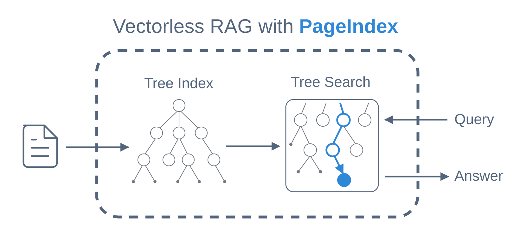
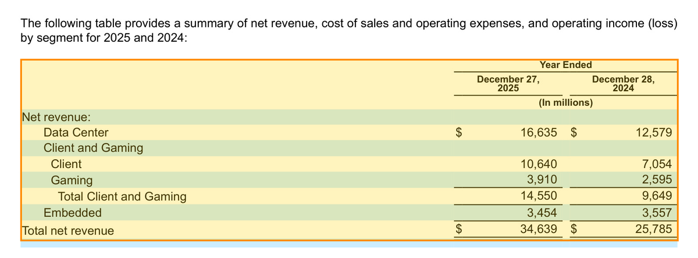
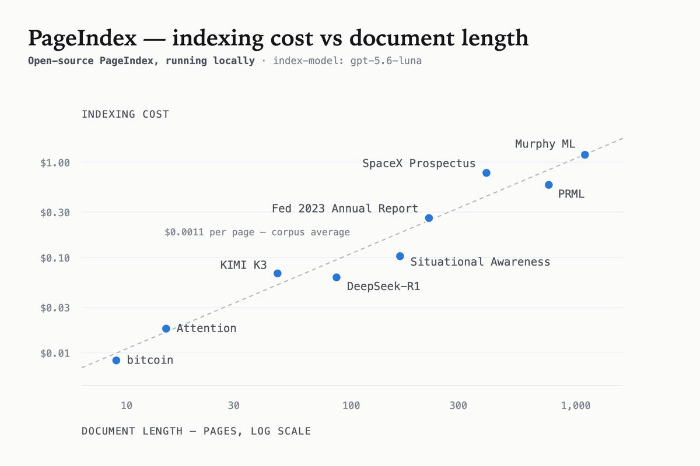
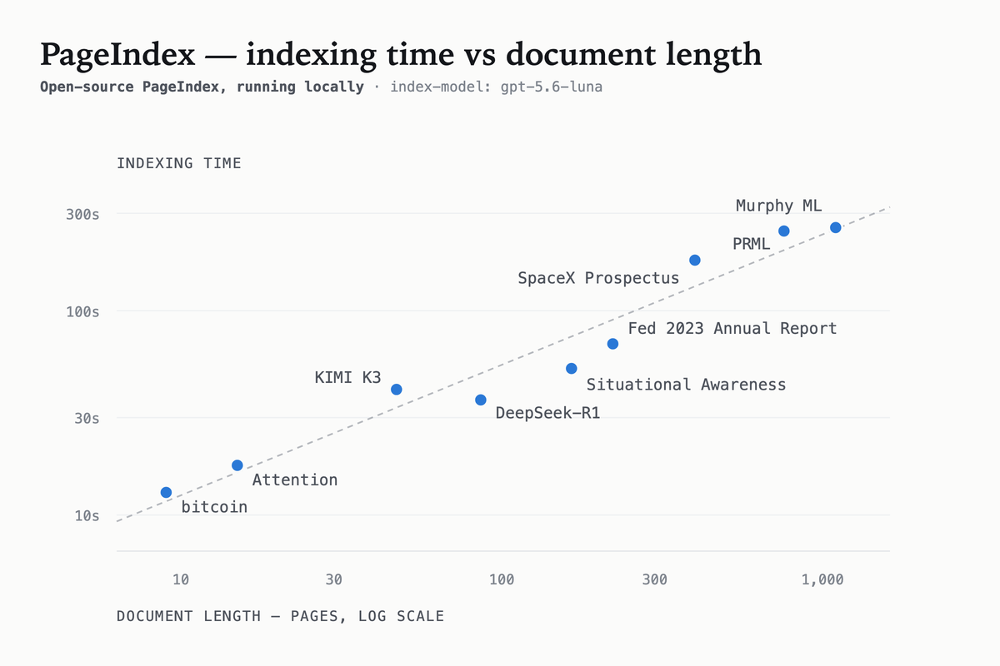
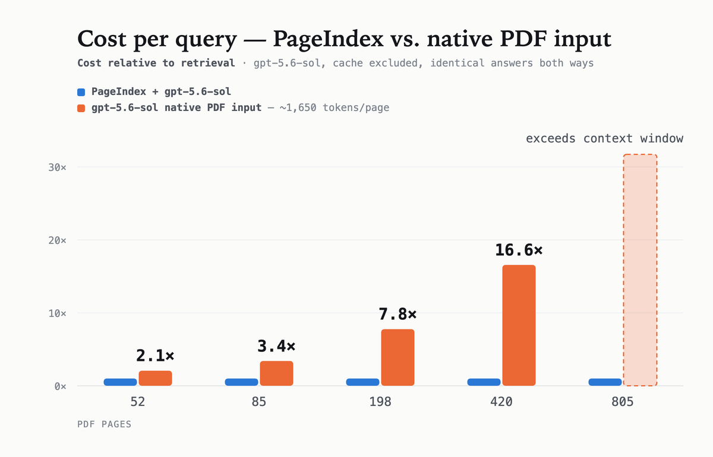
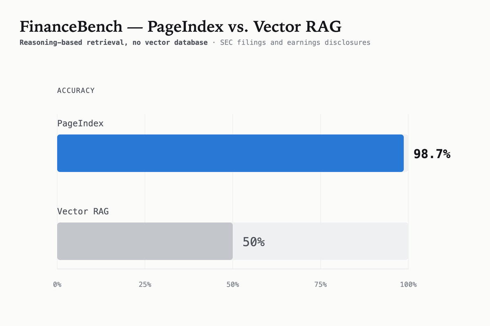

<div align="center">
  
<a href="https://vectify.ai/pageindex" target="_blank">

</a>

<br/>
<br/>

<p align="center">
  <a href="https://trendshift.io/repositories/14736" target="_blank"></a>
</p>

# PageIndex: Vectorless, Reasoning-based RAG

<p align="center"><b>Reasoning-based RAG&nbsp; ◦ &nbsp;No Vector DB, No Chunking&nbsp; ◦ &nbsp;Context-Aware Retrieval&nbsp; ◦ &nbsp;Reads Like a Human</b></p>

<h4 align="center">
  <a href="https://pageindex.ai/developer">🌐 Website</a>&nbsp; • &nbsp;
  <a href="https://developer.pageindex.ai/">☁️ Cloud</a>&nbsp; • &nbsp;
  <a href="https://docs.pageindex.ai">📖 Docs</a>&nbsp; • &nbsp;
  <a href="https://pageindex.ai/blog">📝 Blog</a>&nbsp; • &nbsp;
  <a href="https://pageindex.ai/contact">✉️ Contact</a>&nbsp;
</h4>
  
</div>


<details open>
<summary><h2>Updates</h2></summary>

- [Nov '26] 🔥 [**PageIndex Agent**](https://pageindex.ai/blog/pageindex-agent): vectorless, OCR-free, multimodal RAG for complex documents, with line-level citations for every answer.
- [Nov '26] 🔥 [**Page Extract API**](https://pageindex.ai/blog/page-extract-api): describe the fields you want in a JSON Schema and get them back from any PDF. *#1 on ExtractBench*, and its standard tier beats every other method at $0.03 a page.
- [Nov '26] [**Do We Still Need OCR?**](https://pageindex.ai/blog/do-we-need-ocr): we removed OCR from every PageIndex product. Reading the original pages raised accuracy and lowered cost.
- [Oct '26] [**Page Search API**](https://search.pageindex.ai): find the pages that answer each question in about a second, and send your LLM only those. *Cut 97% token cost on document question answering*; more accurate and faster than vector search ([benchmark](https://github.com/VectifyAI/page-search-benchmark)).
- [Aug '26] [**PageIndex SDK**](#quickstart): **local** and **cloud** modes — one client to index, retrieve, and chat on your machine (with your own LLM API key) or on [PageIndex Cloud](https://developer.pageindex.ai/).
- [PageIndex App](https://app.pageindex.ai): a human-like document analysis agent for long professional documents.<!-- Also available via [MCP](https://pageindex.ai/developer) or [API](https://pageindex.ai/developer). -->

</details>


# What is PageIndex?

Are you frustrated with vector database retrieval accuracy for long and complex documents? Vector-based RAG retrieves by semantic **similarity**. But **similarity ≠ relevance** — what retrieval actually needs is relevance, and relevance requires **reasoning**. On professional documents that demand contextual understanding, domain expertise, and multi-step reasoning, similarity search misses what is relevant but not similar, and returns what is similar but not relevant.

Inspired by AlphaGo, **[PageIndex](https://vectify.ai/pageindex)** replaces the vector index with a **hierarchical tree index** and lets an LLM **reason** its way through it, the way a human expert turns to and reads the right section of a long report. Retrieval happens in two steps:

1. **Index**: generate a **tree-structure index** for each document
2. **Retrieve**: agentically **search that tree** with LLM reasoning

<div align="center">
  <a href="https://pageindex.ai/blog/pageindex-intro" target="_blank" title="The PageIndex Framework">
    <picture>
      <source media="(prefers-color-scheme: dark)" srcset="https://raw.githubusercontent.com/VectifyAI/PageIndex/main/assets/vectorless-rag-dark.svg">
      
    </picture>
  </a>
</div>


### TL;DR

<blockquote>PageIndex is a <b>vectorless</b>, <b>reasoning-based RAG</b> engine that <b>mirrors how humans read</b>, delivering <b>traceable</b>, <b>explainable</b>, and <b>context-aware</b> retrieval, with <b>no vector DBs</b> or <b>chunking</b>.</blockquote>

### Compare with Vector RAG

| | Vector RAG | **PageIndex** |
|---|---|---|
| **Index** | vector index | tree index |
| **Retrieval** | semantic similarity search | LLM reasoning over the tree |
| **Result** | opaque, “vibe retrieval” | traceable to explicit references |
| **Context** | query embedding only | full context: conversation history, domain knowledge, etc. |

It is ideal for financial reports, legal documents, regulatory filings, technical manuals, medical literature, academic textbooks, and any other long, complex professional document.


# Quickstart

```bash
pip install -U pageindex
```


```python
import os
from pageindex import PageIndexClient

os.environ["OPENAI_API_KEY"] = "your-openai-key"

client = PageIndexClient(
    index="gpt-6-luna",                 # model to build the tree index
    chat="gpt-6.2-sol",                 # model to search the tree
)
doc_id = client.submit_document("report.pdf")["doc_id"]

answer = client.chat("What was the 2023 operating margin?", doc_id=doc_id)
print(answer)
```

### Model Recommendations

- **`index=`: a basic model is sufficient.** The tree structure itself is extracted from the document layout without an LLM; the index model only summarizes and refines it, which a basic model does well.
- **`chat=`: use the best model you can afford.** The chat model searches the tree to retrieve information. See [Query cost and accuracy](#query-cost-and-accuracy).

**Have a Claude subscription?** PageIndex can use your subscription to call Claude models through Claude Code: usage is covered by your plan, no API key needed. Install with `pip install -U "pageindex[claude]"`, then prefix model names with `claude-code/`, e.g., `index="claude-code/haiku"`, `chat="claude-code/opus"`.

# PageIndex Cloud

The open-source version is ideal for text-heavy PDFs and local workflows. With **PageIndex Cloud, document indexing and storage run in the cloud**: PageIndex reads every page visually, with no OCR step ([why](https://pageindex.ai/blog/do-we-need-ocr)), builds the tree index, and stores it for you. The chat and retrieval layer remains **compatible with your model**, so you can search the cloud-hosted index using the model provider your application already uses.

Moving indexing and storage from Local to Cloud only requires a [PageIndex API key](https://developer.pageindex.ai/):

```python
import os
from pageindex import PageIndexClient

os.environ["PAGEINDEX_API_KEY"] = "your-pageindex-key"
os.environ["OPENAI_API_KEY"] = "your-openai-key"

client = PageIndexClient(
    index="cloud",                       # build and store the index in PageIndex Cloud
    chat="gpt-6.2-sol",                  # use your preferred compatible model for chat
)
doc_id = client.submit_document("report.pdf", wait=True)["doc_id"]
print(client.chat("What was the 2023 operating margin?", doc_id=doc_id))
```

### Citations you can see

On Cloud, `citations="cite_with_boxes"` cites each claim with its page and a box around the evidence on that page, so you can show the reader exactly where the answer came from. On AMD's 2025 Form 10-K:

```python
answer = client.chat("What was total net revenue in fiscal 2025?", doc_id=doc_id, citations="cite_with_boxes")
print(answer)
```

```text
AMD’s total net revenue was **$34.639 billion in fiscal 2025**, up **$8.854 billion (34%)** from **$25.785 billion in fiscal 2024**. <cite doc="0000002488-26-000018.pdf" page="71" box="0.055,0.145,0.946,0.336"/>
```

<div align="center">
  
</div>

| | **Local** | **Cloud** |
|---|---|---|
| Handles | Text-based PDFs | Text-based, scanned, and image-rich documents |
| Indexing | On your machine | Managed by PageIndex |
| Storage | Local directory | Cloud storage |
| Citations | Page-level | Page, with a box around the evidence |
| Multimodal understanding | — | ✓ |
| [Collections & metadata](https://pageindex.ai/docs/documents/collections) | — | ✓ |
| [Folders](https://pageindex.ai/docs/documents/folders) | — | ✓ |
| [MCP server](https://pageindex.ai/docs/sdk/agents#connect-over-mcp) | — | ✓ |

### Also on PageIndex Cloud

The same API key and SDK also work with:

- [**Page Search API**](https://pageindex.ai/docs/search/quick-start): find the pages that answer a question.
- [**Page Extract API**](https://pageindex.ai/docs/extract/quick-start): extract fields and tables as JSON.

### Ready to Try It?

- Get a [PageIndex API key](https://developer.pageindex.ai/)
- Read the [PageIndex Cloud documentation](https://docs.pageindex.ai/)

For dedicated deployment (VPC or on-premises), [contact us](https://pageindex.ai/contact) or [book a demo](https://calendly.com/pageindex/meet).

# Usage Guide

Run PageIndex on your machine, step by step. Each step builds on the one before.

## Step 1: Set up the client

<details>
<summary>Install and initialize:</summary>
<br>

```bash
pip install -U pageindex
```

```python
import os
from pageindex import PageIndexClient

os.environ["OPENAI_API_KEY"] = "your-openai-key"

client = PageIndexClient(
    index="gpt-6-luna",                 # model to build the tree index
    chat="gpt-6.2-sol",                 # model to search the tree
)
```

</details>

<details>
<summary>Models and API keys:</summary>
<br>

- **`index=`: a basic model is sufficient.** The tree structure itself is extracted from the document layout without an LLM; the index model only summarizes and refines it, which a basic model does well.
- **`chat=`: use the best model you can afford.** The chat model searches the tree to retrieve information. See [Query cost and accuracy](#query-cost-and-accuracy).

Model names follow [LiteLLM's naming](https://docs.litellm.ai/docs/providers). The two models can come from different providers; set the API key of each provider you use:

| Provider | `index=` | `chat=` | API key |
|---|---|---|---|
| OpenAI | `gpt-6-luna` | `gpt-6.2-sol` | `OPENAI_API_KEY` |
| Anthropic | `anthropic/claude-haiku-5-5` | `anthropic/claude-opus-5-5` | `ANTHROPIC_API_KEY` |
| OpenRouter | `openrouter/anthropic/claude-haiku-5-5` | `openrouter/anthropic/claude-opus-5-5` | `OPENROUTER_API_KEY` |
| Claude subscription | `claude-code/haiku` | `claude-code/opus` | none; install `pageindex[claude]` |

Leave out `index=`, and indexing uses `gpt-6-luna`, which needs `OPENAI_API_KEY`. For other providers, see the [LiteLLM provider list](https://docs.litellm.ai/docs/providers).

Indexed documents are kept in `./.pageindex`. To keep them elsewhere, pass the index side as a dict: `index={"model": "gpt-6-luna", "storage_path": "my-index"}`.

</details>

## Step 2: Index your documents

```python
doc_id = client.submit_document("report.pdf")["doc_id"]
```

`submit_document` builds the tree on your machine: the structure comes from the PDF's own layout, without an LLM, and the index model only writes node summaries and refines the tree.

Local mode works with text-based PDFs. For scanned files and image understanding, use [PageIndex Cloud](#pageindex-cloud).

<details>
<summary>Read and manage your documents:</summary>
<br>

Read what you indexed:

```python
tree = client.get_document_structure(doc_id)    # titles, page ranges, summaries; no text
pages = client.get_page_content(doc_id, "5-7")  # the text of pages 5 to 7
docs = client.list_documents()                  # every indexed document
```

To remove a document, call `client.delete_document(doc_id)`.

A PageIndex tree looks like a table of contents optimized for LLMs and agents:

```jsonc
{
  "title": "Financial Stability",
  "node_id": "0006",
  "start_index": 21,
  "end_index": 22,
  "summary": "The Federal Reserve ...",
  "nodes": [
    {
      "title": "Monitoring Financial Vulnerabilities",
      "node_id": "0007",
      "start_index": 22,
      "end_index": 28,
      "summary": "The Federal Reserve's monitoring ..."
    },
    {
      "title": "Domestic and International Cooperation and Coordination",
      "node_id": "0008",
      "start_index": 28,
      "end_index": 31,
      "summary": "In 2023, the Federal Reserve collaborated ..."
    }
  ]
}
```

See more example [documents](https://github.com/VectifyAI/PageIndex/tree/main/examples/documents) and generated [tree structures](https://github.com/VectifyAI/PageIndex/tree/main/examples/results).

</details>

## Step 3: Ask questions

Ask with your own LLM, or with an agent you already have.

### Option A: With your LLM

`chat()` runs PageIndex's agent on your LLM: it finds the right pages, then writes the answer.

```python
answer = client.chat("What changed in the risk factors?", doc_id=doc_id)
```

<details>
<summary>Streaming:</summary>
<br>

The stream shows the agent's thinking and tool calls as it works; pass `show_process=False` to stream only the answer:

```python
for chunk in client.chat("Summarize this document.", doc_id=doc_id, stream=True):
    print(chunk, end="", flush=True)
```

</details>

<details>
<summary>Citations:</summary>
<br>

Pass `citations=True`, and every claim cites its page:

```python
cited = client.chat("Summarize this document.", doc_id=doc_id, citations=True)
# Revenue increased during the reporting period. <cite doc="report.pdf" page="12"/>
```

`citations="markdown"` writes `[report.pdf, p. 12]` instead. To show the citations, `resolve_citations()` turns the tags into numbered links and lists the sources:

```python
resolved = client.resolve_citations(cited)
print(resolved["answer"])
# Revenue increased during the reporting period. [[1]](#pageindex-citation-01)
for c in resolved["citations"]:
    print(c["index"], c["document"], c["page"])
# 1 report.pdf 12
```

</details>

<details>
<summary>Protocols (Chat Completions / Responses / Messages):</summary>
<br>

`protocol=` returns the response in that API's own shape: `"chat_completions"` or `"responses"` (OpenAI), or `"messages"` (Anthropic, with a Claude model):

```python
response = client.chat("Summarize this document.", doc_id=doc_id, protocol="responses")
print(response["output"])
```

</details>

<details>
<summary>Conversations and multiple documents:</summary>
<br>

**Continue a conversation.** Pass the messages so far in place of the question:

```python
messages = [
    {"role": "user", "content": "What changed in the risk factors?"},
    {"role": "assistant", "content": answer},
    {"role": "user", "content": "Which of these changes matters most?"},
]
answer = client.chat(messages, doc_id=doc_id)
```

**Ask across documents.** Index another document, then pass a list of IDs, and keep the same list for every call in a conversation. Leave out `doc_id` to search every indexed document:

```python
doc_id_2022 = client.submit_document("report-2022.pdf")["doc_id"]
answer = client.chat("How did the operating margin change from 2022?", doc_id=[doc_id, doc_id_2022])
```

</details>

### Option B: With your agent

Your agent keeps its own model and gets PageIndex's tools to find and read your indexed documents, so the client needs no `chat=` here. Name the documents in a first message and put the question in a second:

```python
instructions = client.agent_instructions()     # PageIndex's system prompt, or write your own
messages = [
    {"role": "user", "content": client.document_context(doc_id)},   # one ID or a list
    {"role": "user", "content": "What are the auditor's main concerns?"},
]
```

Leave out the first message to let the agent look across every indexed document. The context guides the agent; it is not a lock.

#### *Agent frameworks:*

Pass `instructions`, PageIndex's tools, and `messages` to your agent framework:

<details>
<summary>OpenAI Agents SDK:</summary>
<br>

Ships with the SDK, no extras needed:

```python
from agents import Agent, Runner

agent = Agent(
    name="PageIndex",
    instructions=instructions,
    tools=client.as_openai_tools(),
    model="gpt-6.2-sol",
)
result = Runner.run_sync(agent, messages)
print(result.final_output)
```

</details>

<details>
<summary>Anthropic SDK:</summary>
<br>

Install with `pip install -U "pageindex[anthropic]"`:

```python
import anthropic

runner = anthropic.Anthropic().beta.messages.tool_runner(
    model="claude-opus-5-5",
    max_tokens=16000,
    system=instructions,
    tools=client.as_anthropic_tools(),          # asynchronous=True for AsyncAnthropic
    messages=messages,
)
final = runner.until_done()
print("".join(block.text for block in final.content if block.type == "text"))
```

</details>

<details>
<summary>Claude Agent SDK:</summary>
<br>

Install with `pip install -U "pageindex[claude]"`:

```python
import asyncio
from claude_agent_sdk import ClaudeAgentOptions, ResultMessage, query

options = ClaudeAgentOptions(
    model="claude-opus-5-5",
    system_prompt=instructions,
    mcp_servers={"pageindex": client.as_claude_mcp()},
    allowed_tools=["mcp__pageindex"],
)

async def input_messages():
    for message in messages:
        yield {"type": "user", "message": message,
               "parent_tool_use_id": None, "session_id": ""}

async def main():
    async for message in query(prompt=input_messages(), options=options):
        if isinstance(message, ResultMessage):
            print(message.result)

asyncio.run(main())
```

</details>

<details>
<summary>Other agent frameworks:</summary>
<br>

```python
tools = client.agent_tools()
```

These are plain Python functions for LangChain, PydanticAI, or any other framework. Each takes JSON arguments and returns a JSON string. Give them and `instructions` to your agent, and pass `messages` as the conversation.

</details>

#### *More options:*

<details>
<summary>Citations:</summary>
<br>

Add the citation prompt to the instructions, and the agent cites each claim's page in the same tags as `chat(citations=True)`. Read them with `resolve_citations()`, as in Citations under With your LLM:

```python
instructions = client.agent_instructions() + "\n\n" + client.citation_prompt()
```

</details>

<details>
<summary>Document management:</summary>
<br>

The tools only read by default. Pass `include_management=True` to both `agent_instructions()` and the tool method, such as `as_openai_tools()`, to also let the agent delete documents.

</details>

<details>
<summary>One-call setup:</summary>
<br>

These helpers return the instructions and tools together, in place of the setup above:

```python
agent = Agent(**client.openai_agent_config(model="gpt-6.2-sol"))
runner_config = client.anthropic_runner_config(model="claude-opus-5-5")
options = ClaudeAgentOptions(**client.claude_agent_config(model="claude-opus-5-5"))
```

</details>


# Benchmarks

### Local indexing cost and time

Building a tree locally runs **about $0.001 per page** with `gpt-5.6-luna` as the index model, so a 1,000-page textbook costs a little over a dollar and a few minutes, once, and every later question reuses it. PageIndex is designed not to rely heavily on the model used at index time, so in our experiments a basic model does not hurt quality.

<div align="center">
<picture>
  <source media="(prefers-color-scheme: dark)" srcset="https://raw.githubusercontent.com/VectifyAI/PageIndex/main/assets/index-cost-dark.png">
  
</picture>
</div>

Indexing time also scales predictably with document length. In the same local setup, the benchmark documents (9 to 1,098 pages) finished in roughly **13 seconds to 4.5 minutes**.

<div align="center">
<picture>
  <source media="(prefers-color-scheme: dark)" srcset="https://raw.githubusercontent.com/VectifyAI/PageIndex/main/assets/index-time-dark.png">
  
</picture>
</div>


### Query cost and accuracy

[**PageIndex Financial QA Benchmark**](https://github.com/VectifyAI/pageindex-benchmarks/tree/main/financial-qa) compares the accuracy and query cost of 34 configurations of 19 LLMs answering 100 questions over 40 Form 10-K filings from 8 companies, with PageIndex doing the retrieval. Cost is measured per 100-question run and excludes one-time indexing.

<div align="center">
<a href="https://github.com/VectifyAI/pageindex-benchmarks/tree/main/financial-qa">
  
</a>
</div>

Full results, data, and reproduction instructions are in the [benchmark repo](https://github.com/VectifyAI/pageindex-benchmarks/tree/main/financial-qa).

### Cost per query vs. native PDF input

The alternative to retrieval is handing the model the whole PDF on every question. That cost grows with the document; PageIndex's does not, because it reads only the nodes its reasoning reaches. On documents where both routes return the same answer, native PDF input costs **2.1× more at 52 pages and 16.6× more at 420** (`gpt-5.6-sol`, prompt caching excluded) — and at 805 pages the document no longer fits in the context window at all.

<div align="center">
<picture>
  <source media="(prefers-color-scheme: dark)" srcset="https://raw.githubusercontent.com/VectifyAI/PageIndex/main/assets/query-cost-dark.png">
  
</picture>
</div>

### Leading accuracy on FinanceBench

PageIndex reached a state-of-the-art [**98.7% accuracy**](https://vectify.ai/blog/Mafin2.5) on [FinanceBench](https://arxiv.org/abs/2311.11944) (financial document QA benchmark), vastly outperforming vector-based RAG.

<div align="center">
<a href="https://github.com/VectifyAI/Mafin2.5-FinanceBench">
<picture>
  <source media="(prefers-color-scheme: dark)" srcset="https://raw.githubusercontent.com/VectifyAI/PageIndex/main/assets/financebench-dark.png">
  
</picture>
</a>
</div>

Explore the full FinanceBench [evaluation results](https://github.com/VectifyAI/Mafin2.5-FinanceBench) and the [blog post](https://vectify.ai/blog/Mafin2.5).


---

# ⭐ Support Us

Leave us a star 🌟 if you like our project. Thank you!  

<p>
  
</p>

Please cite this work as:
```
Mingtian Zhang, Yu Tang and PageIndex Team,
"PageIndex: Next-Generation Vectorless, Reasoning-based RAG",
PageIndex Blog, Sep 2025.
```

<details>
<summary>Or use the BibTeX citation.</summary>

```bibtex
@article{zhang2025pageindex,
  author = {Mingtian Zhang and Yu Tang and PageIndex Team},
  title = {PageIndex: Next-Generation Vectorless, Reasoning-based RAG},
  journal = {PageIndex Blog},
  year = {2025},
  month = {September},
  note = {https://pageindex.ai/blog/pageindex-intro},
}
```
</details>


---

© 2026 [PageIndex AI](https://pageindex.ai)


