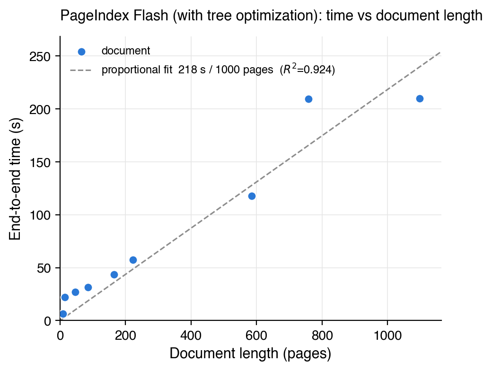

# PageIndex Flash

Builds the PageIndex tree structure from a PDF using layout statistics without
an LLM. Augmenting the tree with summaries and refining it for retrieval needs
an LLM.

## Usage

### Python

```python
from pageindex.flash import page_index_flash

tree = page_index_flash("paper.pdf")                                 # optimized tree + summaries
tree = page_index_flash("paper.pdf", summary=False, optimize=False)  # raw tree only, no LLM
tree = page_index_flash("paper.pdf", optimize="merge")               # deterministic merge, no LLM expand
```

Takes a file path or an `io.BytesIO` stream and returns the tree as a dict.
Summaries are on by default and need an LLM API key.

### Command line

```bash
python3 run_pageindex.py --mode flash --pdf_path document.pdf                             # optimized tree + summaries
python3 run_pageindex.py --mode flash --pdf_path document.pdf --no-summary --optimize off # raw tree only, no LLM
```

Writes the tree to `results/<name>_structure.json`.

## Output

```python
{
    "doc_name": str,
    "doc_title": str,
    "structure": [
        {
            "title": str,
            "node_id": str,       # 4-digit, zero-padded
            "start_index": int,   # 1-based, inclusive
            "end_index": int,
            "summary": str,       # summary=True only
            "key_items": [str],   # optimize only: titles of subsections merged away
            "nodes": [...],       # entries with children only
        }
    ],
    "toc_source": str,  # "detected" | "bookmarks" | "hybrid" | "pages" | "unreadable"
    "diagnostics": {
        "page_count": int,
        "text_page_count": int,
        "textless_pages": [int],  # 1-based pages with no non-whitespace extracted text
        "section_opener_count": int,
        "assembled_heading_count": int,
        "layout_status": str,
    },
}
```

`toc_source` says where the structure came from: `"detected"` from the layout,
`"bookmarks"` from the embedded outline, `"hybrid"` when bookmarks frame the
detected sections. `"pages"` means the layout yielded no hierarchy, so every
page became one node titled `Page N`; past `FLAT_TREE_MAX_NODES` (10) pages that
flat tree comes back without summaries or optimization, and the local client and
CLI refuse it. `"unreadable"` means no page retains text after layout processing
and `structure` is empty; the parser may still have extracted text initially.

### Diagnosing extraction failures

`diagnostics` records what the layout pipeline found, before bookmarks, the
page fallback, or model optimization. It contains counts and page numbers,
without document text. `text_page_count` and `textless_pages` measure non-whitespace
text in the parser's spans before layout cleanup, including line-number removal.
They do not measure whether the text is meaningful or whether it survives cleanup.
`section_opener_count` counts the candidates returned
by the section-opener detector; it is not a count of every possible heading.
`assembled_heading_count` includes nested headings before outline validation.
`layout_status` is one of:

- `accepted`: the layout outline survived validation.
- `no_headings`: outline assembly produced no headings.
- `chapter_validation_failed`: the assembled outline failed the chapter
  count/coverage check.
- `heading_gap_too_large`: the assembled outline failed the heading-gap check.

A bookmark tree can still succeed when the layout outline fails; check
`toc_source` for the final source. Text-only PDFs can have plenty of readable
text without the visual heading signals Flash needs to form a hierarchy.
Zero extracted text does not prove that a PDF is scanned: its text encoding
may also be unreadable to the parser.
If `text_page_count` is positive but `toc_source` is `"unreadable"`, text was
extracted but none remained after layout processing; inspect layout filtering.

Inspect the result without model calls:

```python
from pageindex.flash import page_index_flash
from pageindex.flash.api import flash_rejection_reason

result = page_index_flash("document.pdf", summary=False, optimize=False)
print(result["diagnostics"])
print(flash_rejection_reason(result))  # None if the managed pipelines accept it
```

The local SDK and CLI include these diagnostics in Flash refusal messages.
For readable text without a usable hierarchy, try standard indexing
(`mode="standard"` in the SDK or `--mode standard` in the CLI). When text
extraction itself fails, check the PDF's text layer or run OCR first.
These diagnostics locate the failed stage; they do not identify the cause
of every missed heading or change which outlines Flash accepts.

Every page is in some node: a hierarchy that starts after page 1 is preceded by
a `Preface` node covering the pages before it, as in standard mode.

## Benchmark

Nine PDFs, each run end to end with tree optimization: PDF parse, layout
outline, merge, LLM expand, then a summary for every node.



| Document | Pages | Input tokens | Output tokens |
|---|---:|---:|---:|
| Bitcoin whitepaper | 9 | 8,715 | 4,673 |
| Attention Is All You Need | 15 | 26,805 | 10,183 |
| KIMI K3 | 47 | 85,704 | 35,217 |
| DeepSeek-R1 | 86 | 68,398 | 26,351 |
| Situational Awareness | 165 | 115,130 | 54,347 |
| Federal Reserve 2023 report | 222 | 280,975 | 136,982 |
| 9/11 Commission Report | 585 | 720,624 | 200,202 |
| Pattern Recognition and Machine Learning | 758 | 857,983 | 277,675 |
| Machine Learning: A Probabilistic Perspective | 1,098 | 1,587,265 | 646,958 |
